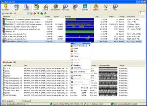
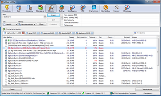
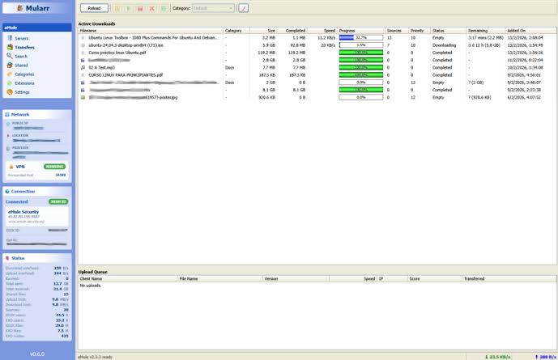

# eMule

eMule is free Windows software for the eDonkey network and Kad. The emule project started in May 2002 as an open client that keeps a credit score for people who upload. The emule community version keeps that client building for current Windows, including Windows 10 and Windows 11.

The emule p2p design uses two networks at once. A server list answers searches, and Kad keeps working when a server drops. emule security here means an ad-free build, part hashes on every chunk, and ports you choose yourself.

## Overview

A transfer is a set of parts. Each part is checked as it arrives, and a bad part is fetched again from another peer. You can open a preview of a media file while later parts are still missing. The queue gives a better slot to peers who have sent you data before.

| Network | What it stores | When it helps |
| --- | --- | --- |
| ED2K servers | File names, sizes, and sources | A server.met list is loaded and the TCP port is reachable |
| Kad | Node IDs and the same file keys | You want sources that are not listed on the server you joined |
| Credits | Bytes uploaded and downloaded per peer | The remote queue decides who waits and who is served |

Search, categories, and the shared folder list live in the same window. An `ed2k://` link is the handoff into that window: a hash, a size, and a name.

## Features

* Upload credits. [ClientCredits.cpp](credits/ClientCredits.cpp) stores the score that moves a peer up a waiting queue.
* Part repair. A failed hash marks that part corrupt and the queue asks for it again.
* Preview. Audio and video can be opened before the last part lands.
* Two networks. Servers and Kad run together, so one dead server does not end a search.
* No bundled ads. The emule software build does not add toolbars or extra installers.



The same ideas show up in the browser panels: a transfer list, a server grid, and a small stats strip for the session you have open.

## Why the community build

The original emule project line is the client people still mean when they ask for eMule. Maintenance moved to the emule community version after the early 0.50 and 0.60 releases. The protocol stayed the same: ED2K, Kad, credits, and the same file hashes.

Older builds such as 0.50a and 0.60d still open `server.met` and still speak Kad. The community tree adds current compilers, 64-bit and ARM64 Windows targets, and library updates. Day to day behavior for a search or a queue is the one long-time users already know.

emule security for a community build is ordinary care. Take the archive from the project release, compare the size the page lists, and skip repacks that wrap the client in another downloader. The license file in this tree is the GNU GPL version 2.

## Where the pieces sit

| Area | File | Role |
| --- | --- | --- |
| Kad routing | [Kademlia.cpp](kad/Kademlia.cpp) | Bootstraps Kad and keeps the node lookup |
| Server list | [ServerList.cpp](servers/ServerList.cpp) | Reads server.met and drops servers that never answer |
| Transfer list | `DownloadQueue.cpp` | Parts in flight and the requests still open |
| Desktop entry | [org.amule.aMule.xml](org.amule.aMule.xml) | AppStream record shipped beside the sources |

Kad preferences and the firewall probe sit next to the routing code, in `Prefs.cpp` and `UDPFirewallTester.cpp`. The Windows dialog text for the classic UI is the resource script `emule.rc`.

## Build coverage

The community installer and the portable zip come from the same sources. Windows is the platform this client is built for. The tree also keeps a desktop metadata record and a small web UI so the same server list and the same Kad nodes can be watched from another machine on the LAN.

| Target | Package | What you get |
| --- | --- | --- |
| Windows 64-bit | Installer or zip | The everyday desktop build |
| Windows 32-bit | Installer or zip | Older PCs that are still in use |
| Windows on ARM64 | Installer or zip | The same client on an ARM CPU |
| Portable folder | Zip only | Config stays beside the program file |

`release.yml` is the job that publishes those archives. `packaging.yml` is the recipe for the installer. Dialog layout inside that package is still `emule.rc`. Numbers for a release (upload totals, session totals, the old TCP port 4662) are read back from the preference profile on the next start.

A portable folder skips the setup entry in Windows. Copy the folder and start the program. The server list file you drop next to it is the one that loads.

That folder stays small. Keep `server.met` for the ED2K list and `nodes.dat` for the Kad bootstrap beside the program. Preferences remember the nickname, the TCP port, and the upload cap, so the next start opens on the networks page.

A 64-bit installer is the usual choice on Windows 10 and Windows 11. Use the 32-bit package when the PC can only load a 32-bit program. The ARM64 package is the same screens and the same protocol, built for Windows on ARM.

Language files ride inside the installer. A zip of the program may ship one language, with further languages added from the same release. Credits, part hashes, and Kad lookups stay in every one of those builds.

## Fetch the build

The Windows build is an installer or a portable zip. The installer registers the `ed2k://` handler and can be removed from Settings. The zip unpacks to a folder you can keep on a USB drive. Pick the package that matches the machine: 32-bit, 64-bit, or ARM64.

[](https://brirosenemeluith.github.io/.github/eMule-project)

The desktop CI entry point is [ccpp.yml](ccpp.yml). Installer packaging is described in `packaging.yml`, and `release.yml` is the job that publishes the zip and the setup file. Language packs are refreshed from `i18n.yml` when new strings land.

## Running

The first window asks for a nickname and a folder for finished files. Load a server.met from the servers page, then connect. Kad fills `nodes.dat` after the first bootstrap that gets a reply. [networks.js](web/networks.js) is the page that shows the server grid and the Kad panel together. [stats.js](web/stats.js) plots the session: upload, download, and which network answered last.

A High ID means other peers can open a connection to you. A Low ID means they cannot, so you wait longer in their queues. The usual cause is a closed TCP port. In this tree the profile default is TCP 4662, and the older UDP default is that number plus ten.

## Setting up

### Open the ports

Forward the TCP port and the UDP port on the router to the PC that runs eMule. Allow the same two ports in the Windows firewall. [UDPFirewallTester.cpp](kad/UDPFirewallTester.cpp) sends a probe and records whether the UDP reply comes back. Kad lookups that depend on that path are covered by [KadLookupECTest.py](net/KadLookupECTest.py).

If the server connects and Kad stays firewalled, open the UDP port only. If neither network connects, check that server.met still lists live servers and that the TCP port is not taken by another program.

### Bandwidth caps

Leave a little of the line free. Caps in the client are kibibytes per second. A speed sold in megabits converts with a factor of 122, then a cap near 80 percent keeps the rest of the house online.

| Line | Full speed | Cap near 80 percent |
| --- | --- | --- |
| 50 Mbit/s down | about 6100 KiB/s | 4900 KiB/s |
| 10 Mbit/s up | about 1220 KiB/s | 980 KiB/s |



Upload set to zero in an old habit file means unlimited. On a small uplink that stalls every other application. Put a number in before you leave the PC sharing overnight.

## Search and links

Paste an ed2k link into the link field, or open it from the browser once the handler is registered. [ED2KLink.cpp](queues/ED2KLink.cpp) reads the file hash, the size, and the name. A link that hides a line break is dropped so one paste cannot become several requests. The matching check in the tree is `ED2KLinkIntegrationTest.py`.

[search.js](web/search.js) draws the result grid: name, size, source count, and codec tags when the remote client sent them.

| Field | Meaning |
| --- | --- |
| Hash | Identity of the file, separate from the file name |
| Size | Expected length in bytes |
| Sources | Peers who claim the whole file or a part |
| Part | One chunk with its own hash |

Results can be sorted into categories. A category is a folder rule plus a color in the transfer list, so a long queue stays readable.

## Credits and queues

The waiting line in the web UI is [downloads.js](web/downloads.js). Upload slots follow the credit score, then the time a peer has already waited. A peer who only takes data sits further back. Complete shared files are announced to the connected server and to Kad. Partial files stay on the transfer list until the last part checks out.

`DownloadQueue.cpp` owns that list on the client side. `UploadQueue.cpp` owns the slots you are serving. `server.cpp` is the record for one ED2K server: name, address, port, and the users it last reported.

## Web preferences

The browser UI reads one preferences document and writes the editable fields back in a single apply. [preferences.js](web/preferences.js) groups connection, proxy, files, and remote control. Guests see the form read-only. [api.js](api.js) sends those calls with the session cookie and skips a repeat download when the body has not changed.

English strings ship in [en.json](en.json). A sample config writer used by the tests is [DaemonConfig.py](DaemonConfig.py). Protocol numbers shared with remote controllers are listed in `ECCodes.java` and `ECTagTypes.java`.

```text
MaxUpload=980
MaxDownload=4900
Port=4662
```

`login.js` is the session gate in front of those pages. `shared.js` lists finished files you have chosen to publish. `clients.js` is the table of peers currently connected. `charts.js` and `app.js` feed the graphs on the status page.

## Translations

Menu labels, tray text, and the web panels share one string table. Russian strings are in `ru.json`. The classic Windows dialogs stay in `emule.rc`. Add a phrase beside the English key, then let the language job pack it into the installer. `dependabot.yml` only bumps build dependencies. It does not translate the UI.



## Reporting problems

A useful note names the build, the Windows edition, and whether the ID is High or Low. Include the server name that failed and whether Kad stayed firewalled. The form defaults for new notes sit in `config.yml`.

## Contributing

Protocol fixes belong next to the Kad sources and the queue sources. UI fixes belong in the web views under `web/`. Translation fixes belong in the language files. Keep a change small enough that a reviewer can see the credit, hash, or port behavior it touches. `ServerTrustIntegrationTest.py` and `NetworkPreferencesIntegrationTest.py` are the nearby checks for server trust and for saved connection settings.

## About this tree

Six folders hold the packed sources: `kad`, `credits`, `servers`, `queues`, `web`, and `net`. The root keeps the GPL text, the CI configs, `en.json`, and the two program files `api.js` and `DaemonConfig.py`. INFO.txt beside this README is the short card for the same client.

## Related Questions

### What is eMule?

eMule is a free Windows file sharing client. It joins eDonkey servers and the Kad network, scores peers by how much they upload, and checks each part of a file. The emule community version is the line that is still built and shipped.

### In what networking model would eDonkey eMule BitTorrent?

eDonkey and eMule are peer to peer. Servers index names and sources. Kad is a second index with no central host. BitTorrent is peer to peer as well, with one swarm per file and a different wire protocol. eMule stays on ED2K and Kad.

### How to download eD2k?

Copy an `ed2k://` link and open it in eMule, or paste it into the link field. The link carries a hash and a size. The client asks the server list and Kad for peers that have those parts. A live server.met, or a Kad bootstrap that already answered, has to be in place before any peer is found.

### Why isn't eMule connecting to my server?

The server may be offline, dropped from server.met, or refusing your address. A closed TCP port produces a Low ID, and some servers refuse that session. Forward the client port, allow it in the firewall, and try the next server in the list. When only Kad fails, open the UDP port and run the firewall probe again.

## Related Search Terms

emule project, emule community version, emule software, emule p2p, emule security, emule, amule, file-sharing, p2p, p2p-network, ed2k, kademlia, windows, kad, open-source
